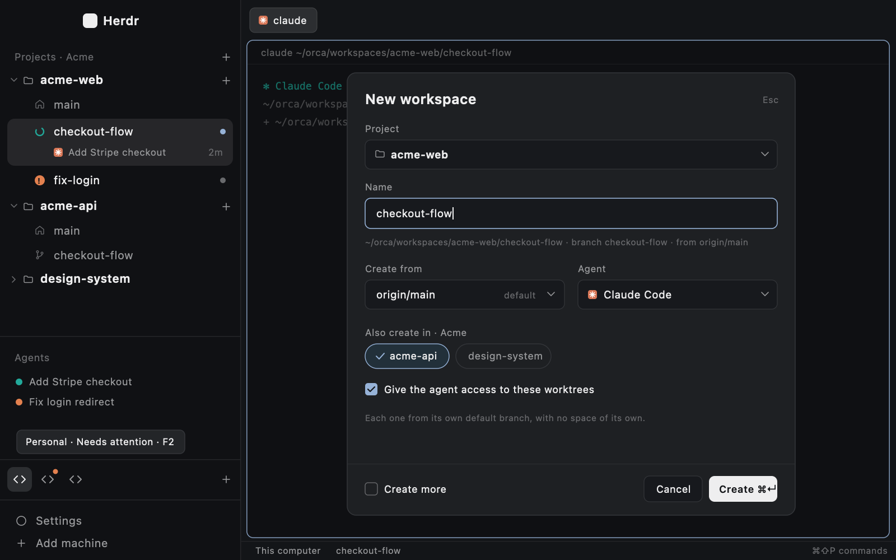

# herdr-plugins

Orca Pro Max features rebuilt as [Herdr](https://herdr.dev) plugins: layouts
and mods in gpui-kit JS, each in Herdr's sharing format (a folder laid out
like Herdr's home, with a `RECIPE.md` and a `preview.png`).

## Plugins

| Folder | What it does |
|---|---|
| [`projects-sidebar/`](projects-sidebar/) | Replaces Herdr's Spaces list with projects and their workspaces (git worktrees), groups switched with F1–F3, Add project, and a New workspace dialog that can make the same branch in companion repos and give the agent access to them. [Recipe](projects-sidebar/RECIPE.md) |
| [`spotlight/`](spotlight/) | Orca Pro Max's Spotlight and test queue: one dev server per repo at its root with the workspace's code projected there, the `spotlight` CLI agents use (`on`/`off`/`status`/`logs`), the test-turn queue with its flask, board and settings, and the sidebar badges. [Recipe](spotlight/RECIPE.md) |
| [`agent-sleep/`](agent-sleep/) | Puts idle Claude Code terminals you aren't looking at to sleep to free memory, and resumes each one when you show its tab, the way Orca's agent hibernation works. Off until you turn it on. |
| [`arc-spaces/`](arc-spaces/) | Cmd-click a link in a terminal and it opens in the Arc space of that workspace's group, with Arc still your default browser. macOS; needs projects-sidebar's groups and one `sudo ln -s`. [Recipe](arc-spaces/RECIPE.md) |



## Install

```sh
git clone https://github.com/JuanEliasJabib02/herdr-plugins
cd herdr-plugins
scripts/install.sh                                # copies projects-sidebar into ~/.config/herdr-app
herdr-app do layout.switch '{"name":"projects"}'  # ctrl-shift-l switches back
```

- `scripts/install.sh` copies the mod and the layout, and never overwrites a
  name it didn't install. It lists what it installed in
  `~/.config/herdr-app/.herdr-plugins/projects-sidebar.txt`. Set
  `HERDR_APP_HOME` for another Herdr home.
- **Requires claude-accounts and spotlight:** the projects layout's status
  bar draws spotlight's test-queue flask and, at its right, the
  claude-accounts plugin's Claude usage. The installer installs the plugins
  listed in `projects-sidebar/requires` first, when this repo has their
  folder. Without one, its block shows "<plugin> did not load".
  `scripts/install.sh --alone` installs projects-sidebar only, and
  `--uninstall` never removes the required plugins.
- **Requires agent-sleep too:** the layout's status bar draws its moon, so it
  is installed the same way. Automatic sleep stays off until you turn it on in
  the popup the moon opens.
- **Commands on PATH:** a plugin's `bin` file lists executables of its mods
  that the installer links as `~/.local/bin/<name>` to the installed copy
  (spotlight's `spotlight` CLI). The link is recorded in the plugin's
  manifest, a foreign file in the way stops the install, and `--uninstall`
  removes it.
- **Keys:** F1–F3 come from the plugin's `keys.json`, which the installer
  merges into yours. It adds only keys you don't use and backs the file up
  first (`keys.json.bak-<time>`). Once your keys.json is edited, Herdr stops
  adding its new default shortcuts to it. In the projects layout, F2 selects
  group 2 instead of renaming the tab. `scripts/install.sh --no-keys` skips
  the merge; then switch groups by clicking, or with
  `herdr-app do projects.group1`.
- **Uninstall:** `scripts/install.sh --uninstall` removes only what the
  install copied. Your keys.json keeps the F1–F3 lines.

## Where workspaces go

New workspaces are git worktrees at `~/orca/workspaces/<repo>/<name>`, on a
branch named like the workspace. Change `WORKTREE_ROOT` in
`projects-sidebar/mods/projects/config.js` to put them elsewhere. The mod runs
`git` in your repos, including `git fetch origin` before creating.

## Develop

```sh
npm test                                              # pure logic, node --test
herdr-app check "$PWD/projects-sidebar/mods/projects" # the mod loads
scripts/install.sh --no-keys                          # copy your edits into Herdr
```

Herdr doesn't load a mod folder that is a symlink, so the installer copies.
After an edit, run it again and Herdr hot-reloads the copy a moment later.
`herdr-app check` draws only the tree view: to check another view, use a copy
whose `main.js` defaults to it.
