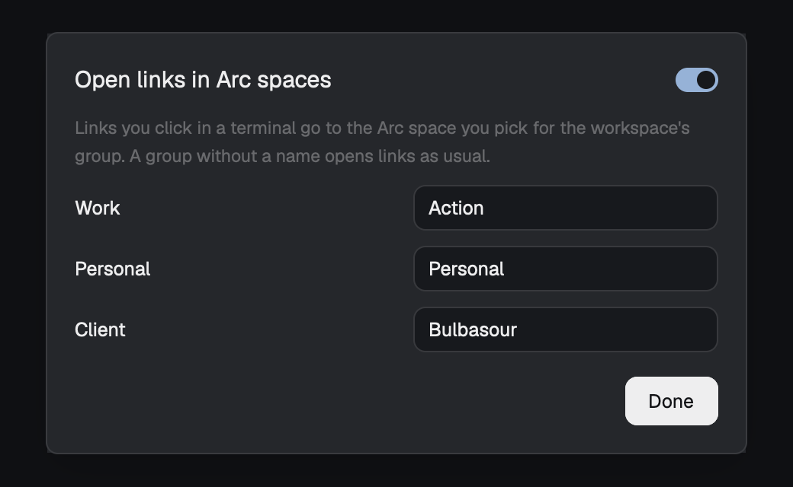

# Arc spaces

Cmd-click a link in a terminal and it opens in the Arc space of that
workspace's group, the way Orca Pro Max does it: one group for work, another
for personal projects, each with its own space in Arc. Arc stays your default
browser, and links from any other app open as they always did.



**What you need**

- macOS, Arc, and `jq` (macOS 15 ships it; before that, `brew install jq`).
- The [projects-sidebar](../projects-sidebar/RECIPE.md) plugin: its groups are
  what get an Arc space. This plugin doesn't install it for you.

**Install**

```sh
scripts/install.sh arc-spaces
sudo mkdir -p /usr/local/bin
sudo ln -s ~/.config/herdr-app/mods/arc-spaces/bin/open /usr/local/bin/open
herdr-app do mod.open '{"name":"arc-spaces"}'
```

The `sudo` lines need your password: `/usr/local/bin` belongs to root, and
it's the folder that comes before `/usr/bin` on Herdr's PATH (`mkdir` only
matters on a Mac that doesn't have it yet). Check that yours does with
`zsh -lc 'which open'`, which should print `/usr/local/bin/open`. If you set
`HERDR_APP_HOME`, link the `bin/open` under it instead.

The dialog from the last line is where you turn it on and type, for each
group, the exact name of its Arc space. It's off until you do, and a group
without a name opens links as usual. The first click asks macOS for permission
for Herdr to control Arc; that click may open in Arc as usual while you answer.

**How it works**

Herdr opens a clicked link by running `open <url>`, by name. The wrapper is
found first and acts only when Herdr itself ran it with one http(s) link. It
asks Herdr which space is shown and where it is now (its first terminal's
folder, the way the projects sidebar places it), finds that place's group, and
runs Orca's AppleScript on Arc. Anything else, and anything that fails (the
space doesn't exist in Arc, Herdr doesn't answer within 3 seconds or Arc within
10), goes to `/usr/bin/open`.

| | Where the link opens |
|---|---|
| Clicked in a terminal, its workspace in a group | That group's Arc space |
| Clicked in a terminal outside every group, or on another machine | The active group's Arc space |
| The group has no name, or the switch is off | Arc, as usual |
| `open` run by you or an agent in a terminal | Arc, as usual |
| Links from other apps | Arc, as usual |
| Links inside panels drawn by mods | Arc, as usual |

**What to keep in mind**

- It relies on how Herdr opens links, which isn't a promised API. If an update
  stops running `open` by name, links go back to opening in Arc as usual, and
  nothing else changes.
- Every `open` in your shells now goes through the wrapper, which hands it
  straight to the real one. If you see `open` misbehave, remove the link.

**Uninstall**

```sh
sudo rm /usr/local/bin/open
scripts/install.sh --uninstall arc-spaces
```

Removing only the plugin is safe too: a link pointing nowhere is skipped, and
`open` finds `/usr/bin/open`. A shell that already ran `open` may remember the
old path and say it's missing: `hash -r`, or a new terminal, fixes it.
