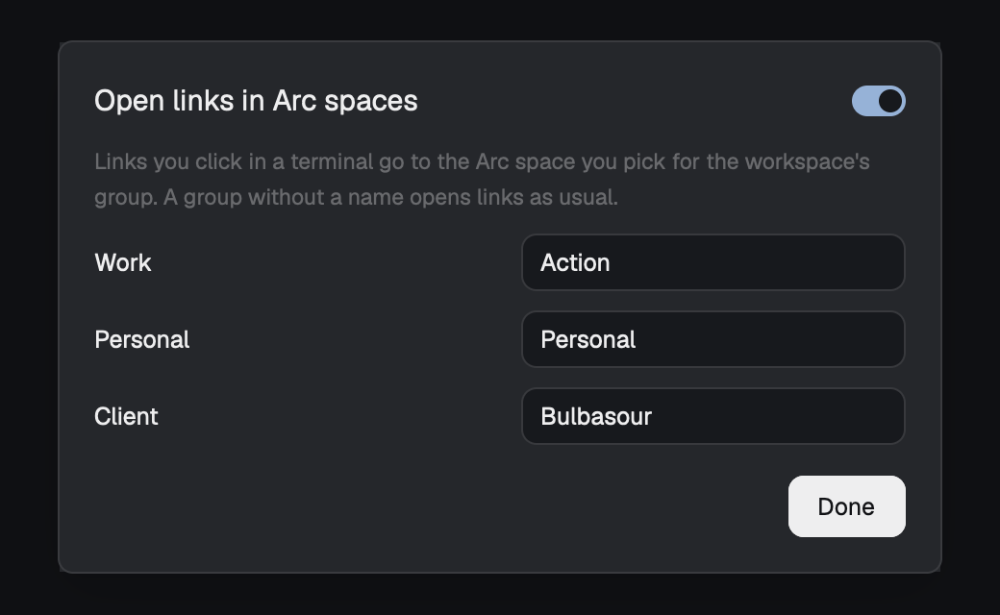

# Dia profiles

Cmd-click a link in a terminal and it opens in the Dia profile of that
workspace's group, the way Orca Pro Max does it with Arc spaces: one group for
work, another for personal projects, each with its own profile in Dia. Dia
stays your default browser, and links from any other app open as they always
did.



**What you need**

- macOS, Dia, and `jq` (macOS 15 ships it; before that, `brew install jq`).
- The [projects-sidebar](../projects-sidebar/RECIPE.md) plugin: its groups are
  what get a Dia profile. This plugin doesn't install it for you.

**Install**

```sh
scripts/install.sh dia-profiles
sudo mkdir -p /usr/local/bin
sudo ln -s ~/.config/herdr-app/mods/dia-profiles/bin/open /usr/local/bin/open
herdr-app do mod.open '{"name":"dia-profiles"}'
```

The `sudo` lines need your password: `/usr/local/bin` belongs to root, and
it's the folder that comes before `/usr/bin` on Herdr's PATH (`mkdir` only
matters on a Mac that doesn't have it yet). Check that yours does with
`zsh -lc 'which open'`, which should print `/usr/local/bin/open`. If you set
`HERDR_APP_HOME`, link the `bin/open` under it instead.

The dialog from the last line is where you turn it on and type, for each
group, the exact name of its Dia profile. It's off until you do, and a group
without a name opens links as usual. The first click asks macOS for permission
for Herdr to control Dia; that click may open in Dia as usual while you answer.

**Coming from arc-spaces**

This plugin is arc-spaces moved to Dia. The switch and the names you saved
there carry over, until you change them here: name your Dia profiles like your
Arc spaces and there's nothing to type. Swap the plugin and point the link at
the new wrapper:

```sh
scripts/install.sh --uninstall arc-spaces
scripts/install.sh dia-profiles
sudo ln -sf ~/.config/herdr-app/mods/dia-profiles/bin/open /usr/local/bin/open
```

**How it works**

Herdr opens a clicked link by running `open <url>`, by name. The wrapper is
found first and acts only when Herdr itself ran it with one http(s) link. It
asks Herdr which space is shown and where it is now (its first terminal's
folder, the way the projects sidebar places it), finds that place's group, and
runs Orca's Arc AppleScript in Dia's words: focus the profile, open a tab in
it. Anything else, and anything that fails (Dia has no profile of that name,
Herdr doesn't say which space is shown within 3 seconds, Dia doesn't answer
within 10), goes to `/usr/bin/open`. If the terminals' folders can't be read
within 3 seconds, the space's own folder is used instead.

| | Where the link opens |
|---|---|
| Clicked in a terminal, its workspace in a group | That group's Dia profile |
| Clicked in a terminal outside every group, or on another machine | The active group's Dia profile |
| The group has no name, or the switch is off | Your default browser, as usual |
| `open` run by you or an agent in a terminal | Your default browser, as usual |
| Links from other apps | Your default browser, as usual |
| Links inside panels drawn by mods | Your default browser, as usual |

**What to keep in mind**

- It relies on how Herdr opens links, which isn't a promised API. If an update
  stops running `open` by name, links go back to opening as usual, and nothing
  else changes.
- Every `open` in your shells now goes through the wrapper, which hands it
  straight to the real one. If you see `open` misbehave, remove the link.

**Uninstall**

```sh
sudo rm /usr/local/bin/open
scripts/install.sh --uninstall dia-profiles
```

Removing only the plugin is safe too: a link pointing nowhere is skipped, and
`open` finds `/usr/bin/open`. A shell that already ran `open` may remember the
old path and say it's missing: `hash -r`, or a new terminal, fixes it.
