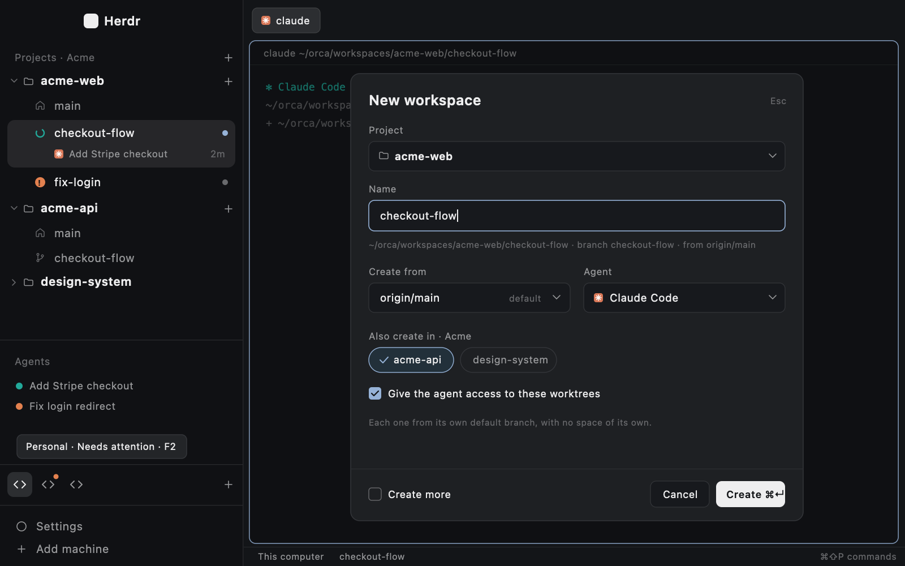

# Projects sidebar

Herdr's Spaces list becomes a list of projects, each with its workspaces (git
worktrees), the way Orca's sidebar works. Projects are sorted into groups you
switch with F1, F2 and F3. Folders that aren't a registered project don't
show. A "+" on a project opens a New workspace dialog. It makes the branch as
a worktree, opens a space for it with your agent, and can make the same
branch in other projects of the group ("Also create in") so one agent works
across repos.



**What you see**

- **Sidebar column** (layout `projects`, a clone of Herdr's `main`): the
  brand block, then the projects tree where Spaces was, the agents list
  (Herdr's, with the tree's working mark),
  the groups bar (44 px), then the footer. Background `chrome`, text 13 px
  in the person's UI font.
- **Projects tree:**
  - Header: 31 px, 11.5 px `dim` text. It reads "Projects · <group>", or
    "Projects" for the default group, with a "+" (Add project) on the right.
  - Project rows: 28 px with rounded 8 corners. Each has a chevron (collapse),
    a folder icon, the repo name in `foreground` semibold, and a "+" (New
    workspace) that brightens on hover.
  - Workspace rows: 28 px, indented 26 px.
    - Leading icon: the agent's status mark while one of its spaces is
      working, blocked or done; otherwise a home icon on the main checkout and
      a branch icon on the others.
    - Label: the branch on the main checkout. On the others, the branch's
      last segment (`user/feat-x` → `feat-x`), or the folder name when
      detached. It is bright when the workspace has a space.
    - After the label, other plugins' badges, if any (see Badges from
      other plugins).
    - A dot on the right when a space is open there: `accent` while shown,
      `muted` otherwise.
    - The shown workspace has a `selected` background.
  - Agent rows: 24 px, under their workspace. Each shows the program's icon,
    the agent's title, and the time since its tab changed ("2m").
  - Empty group: "No projects in this group yet." and an "Add project" button.
    A project git can't list shows "Can't read this folder."
- **Groups bar** (drawn like Orca's, so a long name never takes the bar):
  - One icon chip per group, in creation order: 28 × 28 px with a 16 px code
    icon (`<>`).
  - Hovering a chip shows a tooltip with the name, "Needs attention" or
    "Agent done" when the chip has a dot, and the key on the first three
    ("AG · Needs attention · F3").
  - The active chip has a `selected` background and a `foreground` icon. The
    others are `muted` and brighten on hover.
  - Another group's chip gets a dot at its top right when one of its agents
    is blocked or done: `blocked` if any is blocked, else `done`.
  - A "+" (New group) sits on the right.
- **Task mode** (a group's right-click menu → Organize by Task; Organize by
  Project brings back the tree above). Each group keeps its own mode.
  - Instead of projects, the tree shows task lanes: a bold header with a
    chevron and a count, then that task's workspaces from every project of
    the group, each with its project's name on the right, dim.
  - A task is a ticket found in the branch (`feat/ax-3356-fix` → `AX-3356`)
    or in the folder name. Without one, it is the branch's last segment, so
    the same branch in two projects (one made with "Also create in") is one
    task. A name merges whatever its casing.
  - Lanes go: tickets (newest number first), names (A–Z), "No task",
    "Servers". Servers holds each project's main checkout, or "<name> ·
    Loading…" while a project is still listed.
  - Click a lane header to fold it; folds survive a reload.
  - Right-click a ticket or name lane for its menu: "Add note…" ("Edit
    note…" once it has one), a separator, then "Delete task…" in the
    blocked color, dimmed with "No workspaces" when the lane has none in
    this group. A folded lane has the same menu. "No task" and "Servers"
    have no menu.
  - "Delete task…" deletes every workspace of the lane in this group (main
    checkouts never count), each the way Delete… does, one after another.
    The dialog takes the lane's workspaces when it opens, so one created
    after that is never deleted, and asks git about each. Only the rows git
    allows run: a locked one, one git couldn't check, or one that is no
    longer a workspace says why and is skipped. A row with changes makes the
    button "Delete anyway", which forces that row only. One failure doesn't
    stop the others.
    - All of them deleted: the dialog closes and a toast reads "Deleted 2
      workspaces of AX-3653", with the skipped ones ("Kept 1 locked
      workspace.") and any branch git kept.
    - Otherwise each row shows what happened and the dialog waits for
      Close. Closed meanwhile, one toast gives the count and the first
      failure.
    - The task's note goes once every workspace was deleted, none was
      skipped, and no other workspace, in any group, has the task.
  - A task's note is a word or two to recall it by ("contratos"): a small
    dialog, "Note for AX-3695", with one input. Enter saves, Esc cancels,
    and saving it empty removes the note. It is kept as one line of up to
    30 characters. Hovering the lane shows it as a tooltip, the note only.
    Notes live in Herdr only, per task across every group, and at most 500
    are kept: a new one past that is refused ("500 notes is the most;
    remove one first.").
  - The header gets a branch-icon button, "New workspace", next to Add
    project: the dialog opens on the focused space's project.
- **Narrow sidebar** (under 160 px wide): projects show as initials ("HP" for
  herdr-plugins) with the most urgent status among their workspaces. Group
  chips shrink to 26 px and center, and "+" hides.
- **New workspace dialog:** a 560 × 600 modal with these parts:
  - Project select: the current group's projects only (the space you're in); switch groups for another's.
  - Name input: takes a name, a branch, `#123`, or a GitHub issue / pull
    request or Jira link. Under it, a live line:
    `~/orca/workspaces/<repo>/<name> · branch <name> · from <base>`.
  - "Create from": the project's saved base (D37) marked "default" when
    origin still has it, else `origin/HEAD`'s target; origin's default
    labelled "origin's default"; then the 30 latest remote branches. A
    saved base origin no longer has shows "origin/develop is gone" and the
    workspace starts from origin's default, with a warning. Companions start
    from their own saved base the same way. After a Create, the base the
    primary used is saved as its default (origin's default clears it).
  - "Agent": installed agents plus "Blank terminal".
  - "Also create in · <group>": chips for the group's other projects; a
    chosen chip shows a check.
  - "Give the agent access to these worktrees": a checkbox, shown when a
    companion is chosen.
  - Footer: "Create more", Cancel, and Create ⌘↵.
- **Overlays:**
  - The project menu is a 220 × 300 popup: Open main, New workspace…, Move to
    group ▸, Remove from list.
  - The workspace menu is a 220-wide popup: Copy Path, Copy Worktree Name
    and, on a worktree that isn't the main checkout, Rename… and then
    Delete… after a separator, in `blocked`.
  - The Rename dialog is a 380 × 320 modal:
    - "Rename <label>" and the path with `~`;
    - a "Branch" input, prefilled with the branch and selected;
    - under it, a live line: "branch <old> → <new> · folder <new>", or
      "· folder stays <old> (a terminal is open there)", "(locked by git)"
      or "(has submodules)"; for a name that differs from the branch only
      in case, "Only the case changes: git on macOS can't rename a branch
      that way.", and Rename stays off;
    - for a pushed branch, from the moment it opens, what Rename does on
      origin: "Renames it on GitHub too (<owner>/<repo>).", "Pushes a copy
      as <new>; origin keeps <old>." or "origin no longer has <old>: renames
      it here only.";
    - an open pull request from the branch, in `blocked`: "GitHub closes PR
      #<n> when its branch is renamed.", and the button reads "Rename
      anyway";
    - a refusal in `blocked` once git has checked the typed name: "origin
      already has <new>.", "Branch <new> already exists." (naming the branch
      in the case it has: "Branch ax-1 already exists." for `AX-1`) or
      "<path> already exists." (only when the folder would move); and,
      whatever the name:
      "Couldn't reach origin: <git's first line>.", "Also pushed as
      <remote>/<old>: renaming would split it." or "You can't push to
      <owner>/<repo>.";
    - a detached worktree has no input and no Rename: "<label> is detached
      or in the middle of a rebase.";
    - footer: Cancel, and Rename (solid), off until git has answered
      ("Checking with git…"), "Renaming…" while it runs.
  - The Delete dialog is a 380 × 320 modal:
    - always: "Delete <label>?", the path with `~`, and "Branch <b>" or
      "Detached HEAD";
    - when they apply: "Its N spaces close, with their agents." and "N more
      terminals are in this folder and stay open.";
    - changes or submodules: "<label> has changes that aren't committed.
      They'll be lost." or "<label> has submodules. They're deleted too." in
      `blocked`, and the button reads "Delete anyway";
    - locked: "Locked by git: <reason>. Unlock it with `git worktree unlock
      <path>`." and no Delete button;
    - footer: Cancel, and Delete as a `blocked` outline button, off until git
      has answered ("Checking with git…"), "Deleting…" while it runs.
  - The Delete task dialog is a 400 × 380 modal:
    - "Delete Workspaces" ("Delete Workspace" for one), the task, and Orca's
      "Remove N workspaces from git and delete their workspace folders.",
      counting the rows that will run;
    - how many spaces close and how many other terminals stay, added up
      over the rows that will run;
    - a row per workspace: its label, its project's name on the right, and
      what applies: changes that will be lost, why it is skipped, "Checking
      with git…", "Deleting…", "Waiting…", then what happened;
    - footer: Cancel, and Delete (or "Delete anyway") as a `blocked` outline
      button, off until git has answered for every row, "Deleting…" while it
      runs; only Close once a run left rows behind.
  - The group menu is a 210 × 200 popup: Organize by Project, Organize by
    Task, a separator, Rename…, Delete group. The New / Rename group form is
    a 380 × 214 dialog.

**How it behaves**

- **Status marks:** Claude Code's working glyphs, · ✢ ✳ ✶ ✻ ✽ changing in
  place, in Claude's orange (`working`; Herdr's `spin()` turns at about 30 fps, which stutters),
  "!" (`blocked`), or a dot (`done`).
  Idle and unknown show the home or branch icon. A project row that is
  collapsed shows the most urgent status among its workspaces. The agents
  list's working agents show the same glyphs in the same orange.
- **Click a workspace:** selects its space (when two spaces share it, the
  shown one, else the first). If it has none, opens a space there named
  after its label. Click an agent row: focuses that agent's pane. Click a
  project row: collapse or expand, remembered.
- **Drag a project row** (Project mode) up or down onto another project row:
  a line marks where it lands, and on release the project moves there within
  its group, remembered. Leaving the list, or a new press anywhere else,
  cancels the drag; a drag that ends on its own row changes nothing and
  doesn't fold it.
- **Add project** (header "+", or the empty state's button): a folder
  picker. The repo's main checkout is added to the active group, even if
  you picked a linked worktree or a subfolder. A folder that isn't a repo is
  added as itself. A folder already registered in any group switches to
  that group instead. Then the main checkout's space opens. This works with
  no space open.
- **Right-click a project:** opens the project menu. "Remove from list"
  forgets the project and never touches files, worktrees or spaces. "Move
  to group ▸" lists the other groups. "Default branch…" picks the base New
  workspace starts from (kept on the project in `projects.v1` as `base`,
  e.g. `origin/develop`): origin's default first (clears it), then the
  saved one, then the latest remote branches.
- **Right-click a workspace:** opens the workspace menu. Copy Path and Copy
  Worktree Name (the folder's name) go to the clipboard, and a toast says
  "Copied".
- **Delete…** (never on the main checkout): the dialog asks git first, on a
  fresh `worktree list`: the lock, `status` with untracked files, and
  submodule checkouts as git counts them. Delete then runs, in this order:
  1. It checks again. A path that isn't a worktree of the project, a lock,
     or changes or submodules the dialog didn't show: nothing runs, and the
     dialog says why.
  2. The workspace's spaces close (`space.close`, confirmed), with their
     agents. It waits until they are gone, 3 s at most.
  3. `git worktree remove` runs in the main checkout, with `--force` only
     after "Delete anyway". A new listing decides: still listed means the
     error stays in the dialog.
  4. The branch: `git branch -d`, never `-D`. It is skipped when detached or
     checked out in another worktree. A branch git doesn't see as merged
     stays, and a toast reads "Kept branch <b>".
  5. The fresh list is stored, so the row goes at once.
  - While it runs, Esc, Cancel and clicks do nothing. It runs in a task no
    view owns, so it finishes even if the dialog closes; the outcome is then
    a toast.
  - Every outcome is read from git's state (the list, the refs, the exit
    code), never from its words, which change with the locale and the
    version.
- **Rename…** (never on the main checkout): the input starts as the branch,
  and the untouched branch never renames. Each `/` segment of the name is
  slugged like a new workspace's (`Fix Login!` → `Fix-Login`), so `user/feat`
  keeps its namespace; a `HEAD` segment is dropped and a `.lock` ending
  goes, in any case. A name that differs from the branch only in case
  (`AX-1` for `ax-1`) counts as unchanged: on macOS git finds that branch
  already there, and the live line says so. Other names are compared the
  way a Mac's disk does, ignoring case: a new name is refused, before
  anything changes here or on origin, when a local branch has it (packed
  ones too: `ax-1` refuses `AX-1`), when a local branch would sit under or
  over it (`feat` refuses `Feat/y`, `Feat/x` refuses `feat`), or when a
  remote's copy (`origin/ax-1`) or origin itself has it or such a
  neighbour. On open the dialog asks git whether the folder can
  move (a fresh `worktree list`: the lock, and submodule checkouts as Delete
  counts them), and it checks the typed name a moment after typing stops.
  - **A pushed branch** (a copy on a remote, or an upstream of its own
    name) is decided by what origin has, read once with `git ls-remote
    --heads origin` (only `refs/heads/<old>` before a name is typed); whole
    names count, ignoring case, so `someone/<new>` doesn't and `ax-1` does
    for `AX-1`:
    - origin has `<new>` in any case → refused;
    - another remote has `<old>` too → refused, since renaming would split
      it;
    - origin no longer has `<old>` (a merged PR's deleted branch) → renamed
      here only, and its upstream is unset;
    - origin has `<old>` and is GitHub (`git remote get-url origin`, with
      `ssh -G` for an ssh alias) and `gh api repos/<o>/<r>` says you can
      push → the GitHub path, with the open PRs from `<old>` listed;
    - no `gh`, not logged in, an origin that isn't GitHub, or a PR list
      that fails → the copy path; `gh` saying you can't push → refused;
    - origin unreachable → refused.

    A branch that was never pushed (one that only tracks `origin/main`
    included) needs no network.

  Enter then runs, in this order:
  1. It checks again, on a fresh list: a worktree of the project, on a
     branch; the new branch free here and on origin; the new folder free
     when the folder would move. If what origin has, or its open PRs,
     changed since the dialog showed them, nothing runs and the dialog
     shows the new state. Otherwise nothing runs, and the dialog says why.
  2. On origin first, for a pushed branch: on GitHub, `gh api -X POST
     repos/<o>/<r>/branches/<old>/rename`; on the copy path, `git fetch` of
     origin's `<old>`, then `git push` of that same commit as `<new>`
     (nothing unpushed goes up; your hooks run). Origin's state then
     decides, looked at again for a few seconds while GitHub finishes. If
     origin doesn't show `<new>`, nothing changes here.
  3. `git branch -m <old> <new>` in the main checkout. If that fails after
     origin is done, a toast says how to finish it by hand.
  4. The upstream: `origin/<new>` after a remote step (written as config,
     then that one branch is fetched); otherwise an upstream with another
     name (the `origin/main` a new workspace starts from) is unset, so a
     push never lands there.
  5. The folder moves only when no space and no terminal is in it:
     `git worktree move` to a sibling named after the branch's last segment
     (`…/app/feat-login` → `…/app/signup`). A new listing decides; if git
     kept the folder, a toast says why. Otherwise the folder stays, and the
     row shows the new branch anyway.
  6. Once the branch is renamed here, the workspace's spaces still named
     after the old branch (its last segment, the name a click gave them)
     take the new one with `space.rename`, so the agents list, which shows
     space names, says what the tree says. A space you named otherwise
     keeps its name, and so does one nobody named.
  7. The fresh list is stored, so the row changes at once.
  - While it runs, Esc, Cancel and clicks do nothing. It runs in a task no
    view owns, so it finishes even if the dialog closes; the outcome is then
    a toast.
  - Like Delete, every outcome is read from git's state (the refs, the
    list, what origin lists), never from its words.
- **Groups:** F1/F2/F3 (in this layout only) select groups 1–3, and a
  missing group does nothing. "+" opens the form: Enter creates and selects
  the group, Esc cancels. Right-click a chip: Organize by Project or by Task
  (the current one checked), Rename…, or Delete group, which only works on
  an empty group that isn't the last one.
- **New workspace:**
  - Opens from a project's "+", Task mode's header button, the project menu
    or `projects.new-workspace`
    (the focused space's project, else the active group's first).
  - Choosing companions: each gets a worktree with the same branch from its
    own default branch, and no space.
  - A name taken in any chosen repo, by a branch (packed ones too) or a
    folder, in any case (`ax-3735` takes `AX-3735`, as a Mac's disk does),
    becomes `-2`, `-3`… for all of them.
  - ⌘↵ creates:
    1. A fetch from origin, in every repo at once. A failure warns and the
       create continues.
    2. The companions' worktrees.
    3. The primary's worktree.
    4. One space on the primary, with the agent.
  - With companions and access on, Claude gets `--add-dir <path>` per
    companion and `--settings {"env":{"CLAUDE_CODE_ADDITIONAL_DIRECTORIES_CLAUDE_MD":"1"}}`,
    so it reads their CLAUDE.md. Codex gets only the `--add-dir`s.
  - A pasted link also becomes the agent's first message: `Complete <url>`.
  - Create more keeps the project, base and agent, clears the name and stays
    open.
- **What moves:** a worktree made or removed outside Herdr shows up within
  a moment (the repo's `.git/worktrees` is watched). A 60 s fallback runs
  while the window is in front.

**Built from**

- **Layout `layouts/projects.json`:** Herdr's `main` tree with block
  `spaces` → `{ "mod": "projects" }`, and a new block `groups` →
  `{ "mod": "projects", "props": { "view": "groups" } }` (px 44) between
  `sidebar-lists` and `sidebar-footer`. The status bar (`status`, px 28)
  is a row: `workspace-status`, then `{ "mod": "claude-accounts", "props":
  { "view": "footer" } }`, Claude's usage at its right as in Orca, both
  weight 1 (the claude-accounts plugin draws it), and last
  `status-agent-sleep` → `{ "mod": "agent-sleep" }` (px 40): the agent-sleep
  plugin's moon, which must be in the shown layout for its loop to run. Block
  `agents` → `{ "mod": "projects-agents" }`. Preview `layouts/projects.svg`.
- **Mod `mods/projects-agents/`:** a copy of Herdr 0.1.13's shipped
  `agents` mod, made the way `mod.clone` makes one (`mod.json` records
  `cloned_from: { name: "agents", version: "0.1.13" }`, and the sort menu
  opens `projects-agents`'s own overlay). The only change: a working agent's
  mark is the projects tree's glyphs in Claude's orange instead of Herdr's
  spinner. Herdr never updates this copy, so a newer Herdr's changes to its
  agents list don't reach it. Herdr's Apache 2.0 license is in the folder.
- **Mod `mods/projects/`** (`mod.json` `{ "place": "none" }`), one mod in
  views picked by `props.view`:
  - none = `tree.js` (the tree; the only copy that reads key commands);
  - `groups` = `groups.js`;
  - `new-workspace` = `new-workspace.js`;
  - `delete-workspace` = `delete-workspace.js`;
  - `rename-workspace` = `rename-workspace.js`;
  - `task-menu` = `task-menu.js`, `task-note` = `task-note.js`,
    `delete-task` = `delete-task.js`;
  - `project-menu`, `workspace-menu`, `group-menu`, `group-form`.
  - Pure logic is in `lib.js`, `tree-model.js`, `task-model.js`,
    `new-workspace-model.js`, `remove-workspace-model.js`,
    `rename-workspace-model.js` and `badges-model.js`, tested with `node
    --test` (Delete's and Rename's against a real git).
  - `store.js` is the only code that touches the shared keys: `projects.v1`
    (groups and projects), `projects.ui.v1` (collapsed), `projects.cache.v1`
    (worktree lists), `projects.agents.v1` (`knownAgents()`) and
    `projects.notes.v1` (task notes). A stored `projects.v1` with a malformed
    group or project keeps the valid rest, and the original is copied to
    `projects.v1.backup` before the first write over it; a malformed
    `projects.notes.v1` goes to `projects.notes.v1.backup` the same way.
    It also reads the badge keys `badges.spotlight`, `badges.pr` and
    `badges.hibernate`, read-only: other plugins write them, and this
    plugin never writes or clears one.
  - `config.js` holds `MOD`, `WORKTREE_ROOT` (`~/orca/workspaces`) and
    `BADGE_KEYS`.
- **Commands:** `projects.add`, `projects.add-here`, `projects.new-workspace`,
  `projects.group1`..`projects.group3`, `projects.ping`. `keys.json` binds
  F1–F3 in section `layout:projects`.
- **Herdr functions:** `spaces`, `panes`, `agents`, `focused`,
  `knownAgents`, `layout`, `window`, `home`, `pickFolder`, `watchFolder`,
  `exec`, `run` (`space.select`, `space.new`, `space.close`, `pane.focus`),
  `openOverlay`, `closeOverlay`, `shared`, `setShared`, `notify`, `theme`,
  `props`, `nextCommand`.
- **Programs it runs:**
  - `git`, in the registered repos: `rev-parse --git-common-dir`,
    `worktree list --porcelain`, `for-each-ref`, `show-ref`, `fetch origin`
    (network) and `worktree add`. Delete adds `status --porcelain`,
    `rev-parse --git-path modules`, `ls-files --stage -z`, `worktree remove`
    and `branch -d`. Rename adds `config --get` (the branch's upstream),
    `branch -m`, `branch --unset-upstream` and `worktree move`; for a
    pushed branch, `ls-remote origin` (network), `remote get-url origin`,
    `fetch origin` of one branch, `push origin` (the copy), `config
    --replace-all` (the upstream) and `update-ref -d` (the local
    `origin/<old>` GitHub renamed away).
  - `gh api` (Rename of a pushed branch on GitHub): `repos/<o>/<r>` (can
    you push), `repos/<o>/<r>/pulls` (open PRs from the branch) and
    `branches/<old>/rename`, run in the repo with your gh account.
  - `ssh -G <host>`, to read which host an ssh alias of origin's URL is.
  - `test -e`, to check whether a folder exists.
  - Whatever program another plugin's badge names in its `exec`, when you
    click that badge; its hover says which ("· runs <program>").
- **Art:** its own Lucide-style icons in `icons/` (folder, branch, home,
  plus, code, copy), plus chevrons, check, x and square-pen from
  Herdr's `workspace-chrome` and agent icons from Herdr's `icons/`.

**Badges from other plugins**

Other plugins can put small indicators ("badges") on workspace rows, the
Spotlight plugin first. This plugin knows none of them: it reads, draws and
runs what they publish. This section is the contract a publisher codes
against.

- **Keys:** `badges.spotlight`, `badges.pr` and `badges.hibernate`, read in
  that order (`config.js` `BADGE_KEYS`). A plugin writes only its own key,
  with `setShared(key, value)`; each write replaces the whole value, every
  path at once. Adding a plugin is one line in that list.
  There is no index key listing the plugins: shared state keeps the last
  write, so two plugins adding themselves to one list at start would race.
- **Value:** `{ [workspacePath]: [badge] }`.
  - A path is the workspace's folder, absolute, spelled as `git worktree
    list` prints it (a trailing slash is ignored). Any other key is ignored.
  - A value that isn't an object (`null`, a string, a list) is no badges.
  - A path whose value isn't a list draws nothing there.
- **A badge:** `{ icon?, text?, tone?, tooltip?, action? }`.
  - `icon`: an SVG under Herdr's home (`~/.config/herdr-app`),
    `mods/<mod>/…/<name>.svg` at any depth, with no `..`, empty segment or
    backslash. Drawn 12 px, tinted. Build it from your mod's folder name:
    an install may have renamed it.
  - `text`: at most 16 code points (a longer one is cut), on one line:
    runs of whitespace become one space.
  - `tone`: `accent`, `dim`, `working`, `blocked` or `done`, the theme's
    colors of those names; anything else is `dim`.
  - `tooltip`: at most 200 code points (a longer one is cut), on one line
    like `text`: runs of whitespace (newlines too) become one space, so
    what a click runs, shown after it, stays in view.
  - A badge needs an icon or a text; one with neither is dropped.
  - A field that breaks a rule is dropped alone: a bad icon or action goes
    and the rest of the badge stays. Unknown fields are ignored.
- **`action`:** `{ "command": "<mod>.<command>" }` or
  `{ "exec": [program, ...args] }`, never both (both drop the action):
  - `command` must match `^[a-z0-9][a-z0-9-]*\.[a-z0-9][a-z0-9._-]*$`,
    and the part before its first `.` must be your key's first name after
    `badges.`: a badge under `badges.spotlight` (or `badges.spotlight.v2`)
    may run `spotlight.toggle`, never `pr.open` nor `app.quit`. `run` also
    runs Herdr's own commands (`app.quit`, `window.close`, `app.reset`…),
    so any other command drops the action. A mod an install renamed
    (`spotlight-2`) can't use `command`, since its commands no longer match
    its key: use `exec`. It goes through `run(command)`:
    it reaches that mod's shown copies only, with no args
    (`nextCommand()` yields only the name), and it can't report a failure
    (`run` returns null). An action that needs args, or must say it
    failed, uses `exec`.
  - `exec`: 1 to 20 strings, each at most 500 chars, with no NUL.
    `argv[0]` is a bare name (no `/`) or an absolute path. A relative path
    (`./x`, `bin/x`) drops the action: it would run a file from whatever
    branch the workspace has checked out. Prefer an absolute path.
  - An `exec` click runs `exec(argv[0], argv.slice(1), { cwd: <the
    workspace's folder> })`: argv only, never a shell. It gets Herdr's
    environment, whose PATH is `~/.local/bin` and then the login shell's
    (`$SHELL -l`, which reads `/etc/paths` and `.zprofile` but not
    `.zshrc`). So a bare name finds `/usr/local/bin`, but not a folder only
    `.zshrc` adds to PATH. exec stops it after 30 s.
  - A non-zero exit, or a program that can't start, shows a warning toast
    titled with the program's name: stderr's first line, else "exited with
    code N". While a badge's program runs, more clicks on it are ignored.
- **Limits:** at most 3 badges per plugin on a row, and 4 per row in all,
  in key order; the rest aren't drawn.
- **Drawing:** after the workspace row's label, in Project and Task modes,
  main checkouts included, never on the narrow rail. The icon, then the
  text (11.5 px), in the tone's color. The row's badges share 128 px (one
  badge up to 72 px, four up to 29 px each, 4 px apart), and a long text
  ends in "…", so the label keeps its room. The hover shows the tooltip,
  then what a click runs: "· runs <argv[0]>" or "· <command>".
- **Clicks:** a click runs the action and doesn't open the workspace. A
  right-click opens the workspace menu, as on the row, and never runs the
  action. A badge without an action clicks like its row.
- **Lifetime:** the format only grows; a breaking change gets a new key
  (e.g. `badges.spotlight.v2`). A publisher clears its own paths, and its
  key (`setShared(key, null)`), when they no longer apply: a stale badge
  stays until it does.
- **Example:** this `badges.spotlight` value draws a "live" badge in the
  `working` color on one workspace. Its hover reads "Spotlight is on · runs
  /usr/local/bin/spotlight", and a click runs that program with the three
  args, in that workspace's folder:

  ```json
  {
    "/Users/you/orca/workspaces/app/login": [
      {
        "icon": "mods/spotlight/icons/spotlight.svg",
        "text": "live",
        "tone": "working",
        "tooltip": "Spotlight is on",
        "action": { "exec": ["/usr/local/bin/spotlight", "toggle", "--workspace", "/Users/you/orca/workspaces/app/login"] }
      }
    ]
  }
  ```

**Watch out**

- **This mod runs git and reaches the network:** `git fetch origin` in
  every repo you create in, and `ls-remote`, `fetch`, `push` and `gh` when
  you rename a pushed branch. It reads repo folders outside its own and
  writes worktrees under `~/orca/workspaces`. Change `WORKTREE_ROOT` in
  `config.js` to put them elsewhere.
- **Install by copying.** Herdr doesn't load a mod folder that is a
  symlink ("no mod folder …"). `scripts/install.sh` copies the files and
  lists them in `<home>/.herdr-plugins/projects-sidebar.txt`.
- **A command sent while the mod reloads is lost** (no error). Wait for the
  reload before scripting `herdr-app do projects.*`.
- **Never launch the agent as `env VAR=1 claude`:** Herdr then sees `zsh`,
  not an agent, and shows no status. Use `claude --settings '{"env":{…}}'`.
- **Merging `keys.json`:** F1–F3 need the plugin's `keys.json` merged into
  yours. Once edited, your keys.json no longer receives Herdr's new default
  shortcuts. In this layout, F2 replaces Herdr's `tab.rename`.
- **Delete deletes.** It removes the worktree's folder, its uncommitted
  work after "Delete anyway", and its merged branch. Its spaces close with
  their agents, including an agent session running in that worktree.
- **Delete task deletes several workspaces at once,** in every project of
  the group, with their spaces and agents. It keeps going past one that
  fails. Its run, like Delete's, finishes even when the dialog closes; a
  reload of the plugin stops it before the next workspace.
- **exec's 30 s limit:** `git worktree remove` on a big worktree can hit it.
  The dialog then says "git didn't finish; the folder may be partly deleted.
  Check `git worktree list` in <project>."
- **Locked worktrees** are never deleted from here. Run `git worktree unlock
  <path>` first.
- **`branch -d` keeps squash-merged branches.** A branch merged on GitHub by
  squash or rebase isn't merged for git, so it stays ("Kept branch <b>").
  Delete it yourself with `git branch -D` once you're sure.
- **Rename can change GitHub:** it runs `gh` with your account, and GitHub
  closes a PR opened from the renamed branch. Without `gh` it pushes a copy;
  it never deletes the old branch.
- **A branch on two remotes isn't renamed** ("Also pushed as
  <remote>/<old>: renaming would split it."), and neither is one whose new
  name origin already has.
- **GitHub renames in the background.** If it hasn't shown the new name
  after a few seconds, nothing changes here and the dialog says how to
  check (`git ls-remote origin refs/heads/<new>`) and finish (`git branch -m
  <old> <new>`).
- **The folder stays** while a space or a terminal is in it, or while the
  worktree is locked or has submodules, even when a folder with the new
  name exists. The branch is still renamed, and the row shows it.
- **Claude Code's history after a move:** Claude Code keeps sessions under
  `~/.claude/projects/<old path with dashes>`, so `claude --continue` in the
  moved folder starts fresh.
- **In Task mode there are no project rows,** so a project's own menu (Move
  to group, Remove from list) isn't there: switch the group to Organize by
  Project to move or remove a project. Collapsing a project also only
  applies in Project mode.
- **`herdr-app check` draws only the tree view.** Check the other views
  from a copy whose `main.js` defaults to them.
- **Limits:**
  - Only the first three groups have keys.
  - Branch names have no user prefix and are slugged to 48 characters,
    keeping the case typed (`AX-3735` stays `AX-3735`, as in Orca). A name
    is never `HEAD` (git refuses it, so the dialog asks for a name) and
    never ends in `.lock` in any case (`x.LOCK` becomes `x`: on a Mac's
    disk it is the lock file of `x`).
  - Names are compared ignoring case, as a Mac's disk does, so `ax-1` and
    `AX-1` never both come from the plugin, and a branch can't be renamed
    to a case change of itself.
  - Linear, GitLab and fetching issue titles aren't supported; such a link
    is named by its slug.
  - The main checkout is never renamed or deleted, and a branch is deleted
    only when git sees it merged.
  - Two chosen projects with the same folder name (`/a/web`, `/b/web`) would
    land on the same worktree path: the dialog says so and Create stays off.

**Done when**

- `node --test 'test/*.test.js'` reports `fail 0`, and `herdr-app check`
  passes on `mods/projects`.
- After `scripts/install.sh` and `layout.switch {name: "projects"}`, the
  sidebar shows "Projects" with an empty state. The groups bar shows one
  highlighted code icon whose tooltip reads "Projects · F1".
- With a space open in a repo, `herdr-app do projects.add-here` lists that
  repo with `main` (home icon, open dot) and its other worktrees.
  A space in a folder outside every project is not shown.
- `layout.resize {id: "sidebar", px: 76}` shows initials in the tree and
  smaller, centered chips in the groups bar.
- With keys.json merged, F1–F3 select groups 1–3 while a terminal has focus,
  and F2 no longer opens Rename tab in this layout.
- `herdr-app do projects.new-workspace` opens the dialog on the focused
  space's project, with `origin/main` (or the repo's default) marked
  "default".
- Creating `demo` with one companion makes `~/orca/workspaces/<repo>/demo`
  in both repos, on branch `demo`. It opens one space, and its agent was
  started with `--add-dir` for the companion.
- Right-click a throwaway worktree → Delete… → Delete: its space closes, and
  its folder, its row and its merged branch are gone. A dirty one asks
  "Delete anyway"; a locked one has no Delete.
- With a throwaway task `odd-t14` (one worktree in each of two projects of
  a Task-mode group, one holding an untracked file), right-click its lane →
  Delete task…: the button reads "Delete anyway", and afterwards both
  folders, both merged branches and the lane are gone, and so is its note.
- Right-click a throwaway worktree → Rename… → a new name → Enter: with no
  terminal in it, its branch and its folder take the name. With a space
  open there, the folder stays and the row shows the new name. A branch
  pushed with `-u` to a GitHub origin is renamed there too: `git ls-remote
  origin refs/heads/<new>` lists it, `refs/heads/<old>` is gone, and its
  upstream is `origin/<new>`.
- Right-click the group's chip → Organize by Task: the tree shows task lanes
  (`test`, `test-2`, … then "Servers" with `main`), each row naming its
  project. A folded lane stays folded after a reload. Organize by Project
  brings the tree back.
